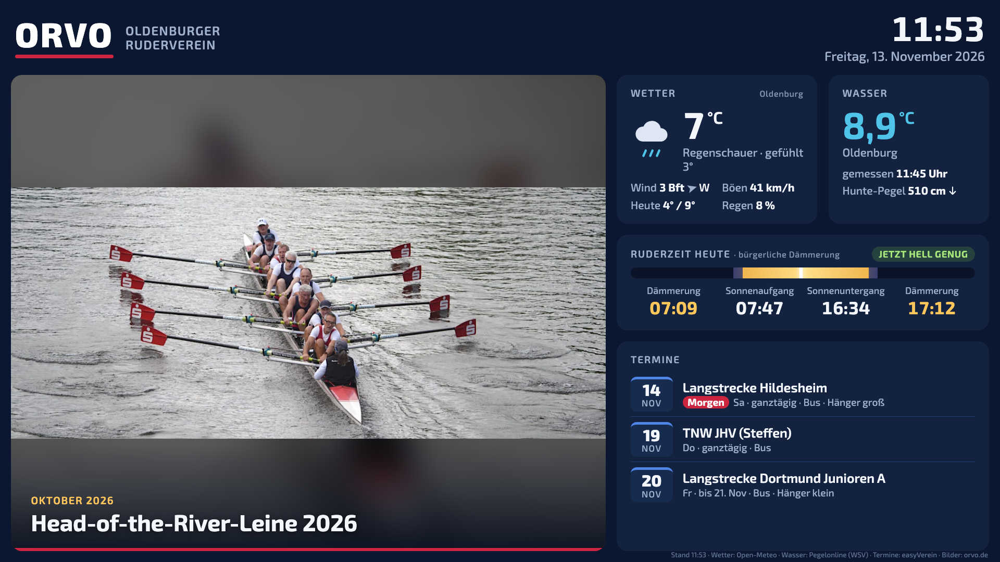

# ORVO Eingangsanzeige – Projektdokumentation

Stand: 13. November 2026

Digitale Anzeige für den Eingangsbereich des **Oldenburger Rudervereins (ORVO)**. Ein großer Fernseher und ein kleinerer Monitor zeigen Bilder von Regatten und Vereinsaktivitäten, aktuelle Termine, Wetter, Wassertemperatur und die heutige Ruderzeit.



*Vorschau in 1920×1080 (13. November 2026) mit Terminen aus easyVerein.*

---

## Inhalt

1. [Überblick](#1-überblick)
2. [Hardware](#2-hardware)
3. [Yodeck: Einrichtung und Betrieb](#3-yodeck-einrichtung-und-betrieb)
4. [Die Anzeigeseite](#4-die-anzeigeseite)
5. [Datenquellen](#5-datenquellen)
6. [Einstellungen](#6-einstellungen)
7. [Inhalte pflegen (für Trainer und Redaktion)](#7-inhalte-pflegen-für-trainer-und-redaktion)
8. [Änderungen an der Seite veröffentlichen](#8-änderungen-an-der-seite-veröffentlichen)
9. [Umzug der Seite auf orvo.de](#9-umzug-der-seite-auf-orvode)
10. [Fehlersuche](#10-fehlersuche)
11. [Entscheidungen und Hintergründe](#11-entscheidungen-und-hintergründe)
12. [Offene Punkte](#12-offene-punkte)

---

## 1. Überblick

```
 easyVerein (Kalender)    orvo.de (WordPress)   Open-Meteo   Pegelonline (WSV)
          │ ICS-Abo           Beiträge mit Fotos   Wetter       Wassertemperatur, Pegel
          ▼                          │               │                │
 GitHub Action (alle 30 min)         │               │                │
 → events.json                       │               │                │
          └──────────────┬───────────┴───────────────┴────────────────┘
                         ▼
        Anzeigeseite  (index.html, GitHub Pages)
                         │  als „Web Page“ eingebunden
                         ▼
        Yodeck-Portal  ──►  Yodeck-Player (Raspberry Pi 4)
                                    │ HDMI
                                    ▼
                              HDMI-Splitter
                              ├─► Fernseher (groß)
                              └─► Monitor (klein)
```

| Baustein | Aufgabe |
|---|---|
| **Raspberry Pi 4** mit Yodeck-Image | Spielt die Inhalte ab, wird über das Yodeck-Portal verwaltet |
| **HDMI-Splitter** | Gibt dasselbe Bild auf Fernseher und Monitor aus |
| **Yodeck-Portal** (app.yodeck.com) | Verwaltung: Playlists, Bildschirm, WLAN, Benutzer |
| **Anzeigeseite** (`index.html`) | Eine einzelne Webseite, die alle Daten selbst lädt und darstellt |
| **easyVerein** | Liefert die Termine (Vereinskalender mit Bus-, Hänger- und Raumbuchungen) |
| **GitHub Action** `termine.yml` | Überträgt die Termine alle 30 Minuten aus easyVerein in `events.json` |
| **orvo.de** | Liefert die Fotos (aus Beiträgen) |

Die Anzeige pflegt sich weitgehend selbst: Neue Termine in easyVerein und neue Beiträge auf orvo.de erscheinen automatisch.

---

## 2. Hardware

| Teil | Details |
|---|---|
| Raspberry Pi 4 Model B, 4 GB | Mit SD-Karte (16 GB reichen) und Netzteil |
| HDMI-Splitter | 1 Eingang, 2 Ausgänge; ein Modell mit eigenem Netzteil läuft zuverlässiger |
| Fernseher (groß) und Monitor (klein) | Beide am Splitter |

**Anschluss:** Der Splitter muss am **linken HDMI-Anschluss** des Pi stecken (neben dem Stromanschluss). Yodeck nutzt nur diesen Ausgang.

**Auflösung:** Ein Splitter gibt meist die Auflösung aus, die beide Geräte können. Bei einem 4K-Fernseher und einem Full-HD-Monitor ist das Full HD. Die Anzeigeseite passt sich jeder Auflösung an.

---

## 3. Yodeck: Einrichtung und Betrieb

### 3.1 Konto und Kosten

- Das Yodeck-Konto läuft auf die IT-Adresse des Vereins.
- Der **kostenlose Plan** gilt für **einen** Bildschirm. Da beide Geräte über den Splitter am selben Pi hängen, zählt das als ein Bildschirm.
- Ab dem zweiten registrierten Bildschirm kostet Yodeck Geld (Stand 2026: Basic etwa 8 $ pro Bildschirm und Monat).
- Für die Trainer eigene Benutzer im Portal anlegen (**Users**), statt das Hauptkonto weiterzugeben.

### 3.2 SD-Karte bespielen

1. Raspberry Pi Imager auf einem Computer starten.
2. Gerät: **Raspberry Pi 4**.
3. Betriebssystem: **Freemium and paid-for OS → Digital signage OS → Yodeck Digital Signage → Yodeck Digital Signage Player**.
4. SD-Karte wählen und schreiben.

Alternative: Das Image im Yodeck-Portal herunterladen und im Imager über „Eigenes Image verwenden“ schreiben.

Yodeck lässt sich **nicht** auf ein bestehendes Raspberry Pi OS nachinstallieren; es braucht immer das eigene Image.

### 3.3 Erster Start und Registrierung

1. SD-Karte einsetzen, Splitter anschließen, Strom an.
2. Der Pi braucht Internet (Kabel oder WLAN, siehe 3.4).
3. Auf dem Bildschirm erscheint ein **8-stelliger Code**.
4. Im Portal unter **Monitors/Screens → Add** den Code eingeben.

### 3.4 WLAN

Yodeck kann sich **zwei WLANs** merken: ein primäres und ein sekundäres. Ist das erste nicht erreichbar, nimmt der Pi das zweite.

Einstellen im Portal: **Screens → Pi bearbeiten → Network**. Danach warten, bis rechts unten auf dem Bildschirm die Meldung „Configuring“ verschwindet.

Wenn der Pi noch gar kein Netz hat:
- **Netzwerkkabel** anschließen (am einfachsten), oder
- **WLAN-Assistent:** USB-Tastatur anschließen, **Strg + Alt + F12** drücken, WLAN wählen (auch per QR-Code mit dem Handy), oder
- **SETTINGS.TXT** auf der Boot-Partition der SD-Karte bearbeiten.

> **Wichtig:** WLAN-Einstellungen immer im Portal ändern. Yodeck schreibt die Netzwerkkonfiguration auf dem Pi beim Start aus den Portal-Einstellungen neu. Was direkt auf dem Pi geändert wird, geht verloren.

Für den endgültigen Betrieb im Verein muss das Vereins-WLAN als **primäres** WLAN eingetragen sein.

### 3.5 Anzeigeseite einbinden

1. **Media → Add Media → Web Page**.
2. Adresse: `https://schulze9.github.io/orvo-anzeige/`
   (optional mit `?slide=12` für 12 Sekunden pro Bild, siehe [Abschnitt 6](#6-einstellungen)).
3. Die Web Page einer **Playlist** hinzufügen, Dauer lang setzen (z. B. 24 Stunden). Die Seite wechselt ihre Inhalte selbst.
4. Die Playlist dem Bildschirm zuweisen.

### 3.6 SSH-Zugang (für Wartung)

Yodeck erlaubt einen Shell-Zugang auf Raspberry-Pi-Playern:

1. Portal: **Screens → Pi bearbeiten → Advanced → Security**.
2. **„Allow SSH on the LAN“** einschalten.
3. Bei **„Wifi Wizard / Remote Support Password“** ein Passwort setzen und speichern. Der angezeigte Wert ist nur die verschlüsselte Form und taugt nicht zum Anmelden.
4. Warten, bis „Configuring“ verschwindet.
5. Anmelden mit `ssh user@<IP-Adresse des Pi>`. Benutzer ist wörtlich **`user`**, das Passwort aus Schritt 3. `user` darf `sudo` verwenden.

Die IP-Adresse steht im Portal unter **Screens → Status**. SSH funktioniert nur aus demselben Netz.

Hinweise:
- Auf dem Pi läuft Yodecks eigenes System (Raspbian 10 „buster“). Dienste wie Raspberry Pi Connect laufen darauf nicht.
- Ein Yodeck-Update kann hinterlegte SSH-Keys wieder entfernen. Dann den Key mit `ssh-copy-id` neu installieren.
- Änderungen am System nur mit Vorsicht: Yodeck verwaltet den Pi und kann sie überschreiben.

---

## 4. Die Anzeigeseite

### 4.1 Aufbau

| Bereich | Inhalt |
|---|---|
| **Kopfzeile** | ORVO-Schriftzug, Uhrzeit, Datum |
| **Bilderstrecke** (links, groß) | Fotos aus den letzten Beiträgen auf orvo.de, mit Monat und Beitragstitel; roter Fortschrittsbalken bis zum nächsten Bild |
| **Wetter** | Temperatur, gefühlte Temperatur, Wetterlage mit Symbol, Wind in Beaufort mit Richtungspfeil, Böen, Tiefst-/Höchstwert, Regenwahrscheinlichkeit |
| **Wasser** | Wassertemperatur mit Messzeit, Hunte-Pegel mit Trend (↑ steigt, ↓ fällt, → gleich) |
| **Ruderzeit heute** | Bürgerliche Morgen- und Abenddämmerung, Sonnenauf- und -untergang, Tagesbalken mit aktueller Uhrzeit, Hinweis „jetzt hell genug“ / „noch dunkel“ / „schon dunkel“ |
| **Termine** | Die nächsten Termine aus dem easyVerein-Kalender, mit Datum, Wochentag, Uhrzeit oder Zeitraum, Kalender (z. B. Wanderfahrten) und gebuchten Fahrzeugen/Räumen (Bus, Hänger, Clubraum); Markierung „Heute“, „Morgen“ oder „Läuft“ |
| **Fußzeile** | Uhrzeit der letzten Aktualisierung und Datenquellen |

Gestaltung: dunkelblauer Hintergrund (schont den Fernseher und blendet weniger), ORVO-Rot als Akzent, Schrift „Exo 2“ (ähnlich dem ORVO-Logo). Alle Größen richten sich nach der Bildschirmbreite, die Seite funktioniert in jeder Auflösung.

### 4.2 Technik

- **Eine einzige Datei:** `index.html` mit HTML, CSS und JavaScript. Keine Bibliotheken, kein Server, kein Build-Schritt.
- **Fast alle Daten lädt der Browser selbst** direkt bei den Quellen (CORS erlaubt). Ausnahme: Die Termine liefert easyVerein nur als ICS-Abo ohne CORS und mit geheimem Schlüssel in der Adresse. Deshalb holt eine GitHub Action sie ab und legt sie als `events.json` neben die Seite.
- **Aktualisierung:** Wetter, Wasser, Termine und Bilderliste alle **15 Minuten**; die Uhr alle 5 Sekunden; die Ruderzeit jede Minute.
- **Kompletter Neustart** der Seite alle **6 Stunden**, gegen Speicherprobleme im Dauerbetrieb.
- **Ausfallsicherheit:** Der letzte erfolgreiche Stand jeder Quelle wird im Browser gespeichert (`localStorage`). Fällt eine Quelle aus, zeigt die Seite den letzten Stand leicht abgeblendet weiter an.
- **Sicherheit:** Titel von Beiträgen und Terminen werden als reiner Text eingesetzt, nicht als HTML.

### 4.3 Bilderstrecke im Detail

1. Die Seite lädt die **letzten 10 Beiträge** von orvo.de.
2. Aus jedem Beitrag nimmt sie bis zu **6 Bilder**: zuerst das Beitragsbild, dann die Fotos im Text.
3. Aussortiert werden Bilder unter 400 Pixel Breite, SVG- und GIF-Dateien, Logos und Icons sowie doppelte Bilder in anderer Größe.
4. Aus den verfügbaren Bildgrößen wird die größte bis 2000 Pixel Breite gewählt.
5. Alle **9 Sekunden** blendet die Seite zum nächsten Bild über.
6. Passt das Seitenverhältnis ungefähr zum Bildbereich, füllt das Bild ihn aus. Sonst wird es vollständig gezeigt, und der Rand wird mit einer unscharfen, abgedunkelten Version desselben Bildes gefüllt.

### 4.4 Termine im Detail

Die Termine kommen aus dem Vereinskalender in **easyVerein** (Abo-Adresse „Kalender abonnieren“ im öffentlichen Kalender, nach Anmeldung sichtbar).

**Abgleich** (`tools/easyverein.py`, ausgeführt von der GitHub Action `.github/workflows/termine.yml`):
1. Die Action läuft alle 30 Minuten, jeweils zur 7. und 37. Minute (GitHub startet zeitgesteuerte Läufe oft einige Minuten später). Außerdem läuft sie nach Änderungen am Skript oder Workflow und von Hand unter **Actions → Termine aus easyVerein → Run workflow**.
2. Sie lädt die ICS-Datei. Die Adresse steht im Repository-Secret **`EASYVEREIN_ICS`** und nie im Code.
3. Übernommen werden nur **Titel, Beginn, Ende und Kalendername**. Beschreibungen werden bewusst verworfen, denn sie enthalten Telefonnummern, E-Mail-Adressen und Kontodaten. `events.json` ist öffentlich lesbar.
4. Buchungen derselben Veranstaltung (z. B. „Midwinter“ im Kalender *Bus* und „Midwinter (mittlerer Hänger)“ im Kalender *Anhänger mittel*) werden zu **einem** Termin zusammengefasst. Bus, Hänger und Clubraum erscheinen dann als Hinweis: „Fr · bis 20. Dez · Bus · Hänger mittel“.
5. Der Kalender *Vorstand* wird nicht übernommen.
6. Termine, die easyVerein als 00:00 UTC bis 23:59 speichert, werden als ganztägig gezeigt.
7. Nur wenn sich etwas geändert hat, committet die Action eine neue `events.json`; GitHub Pages veröffentlicht sie danach.
8. GitHub pausiert zeitgesteuerte Workflows nach 60 Tagen ohne Commits. Die Action schaltet sich deshalb bei jedem geplanten Lauf selbst wieder ein (`gh api … /enable`), ohne dafür Commits zu erzeugen.
9. Fehlt das Secret, endet der Lauf mit der Warnung „Secret EASYVEREIN_ICS fehlt“ und ändert nichts.

Von Hand ausführen (z. B. zum Testen): `EASYVEREIN_ICS='<Abo-Adresse>' python3 tools/easyverein.py events.json`. Das Skript braucht nur Python 3.9 oder neuer, keine Zusatzpakete.

**Abruf durch die Seite:** `index.html` lädt die Termine immer von der festen Adresse `https://schulze9.github.io/orvo-anzeige/events.json` (Einstellung `eventsUrl`). GitHub Pages erlaubt den Abruf von jeder Seite aus (CORS). Deshalb funktioniert dieselbe `index.html` auch als lokale Datei oder auf orvo.de.

**Anzeige:**
- Gezeigt werden die nächsten **120 Tage**, höchstens 6 Termine, und nur so viele, wie vollständig in die Karte passen.
- Ganztägige Termine erscheinen als „ganztägig“, mehrtägige als „bis 3. Mai“.
- Für die Kalender Wanderfahrten, Regatten, Vereinstermine und Trainingszeiten ist eine Farbe hinterlegt (Streifen über dem Datum, `COLORS` in `tools/easyverein.py`).
- Gibt es keine Termine, erscheint „Gerade keine Termine eingetragen“.

**Wichtig:** Die Abo-Adresse gehört zum easyVerein-Zugang, mit dem sie abgerufen wurde. Wird dieser Zugang gelöscht oder die Adresse in easyVerein neu erzeugt, die neue Adresse als Secret `EASYVEREIN_ICS` eintragen (**Settings → Secrets and variables → Actions**).

### 4.5 Ruderzeit (bürgerliche Dämmerung)

- Berechnet im Browser nach dem NOAA-Verfahren für den Standort an der Hunte in Oldenburg.
- **Bürgerliche Dämmerung:** Sonne 6° unter dem Horizont. **Sonnenauf-/-untergang:** Sonnenmittelpunkt 0,833° unter dem Horizont (berücksichtigt Lichtbrechung und Sonnenradius).
- Geprüft gegen die astronomische Bibliothek *astral*: Abweichung unter einer Minute (Stichproben 13. November, 21. Juni, 29. März 2026).
- Sommer- und Winterzeit werden automatisch berücksichtigt (Zeitzone des Geräts).

---

## 5. Datenquellen

| Daten | Quelle | Schnittstelle | Schlüssel nötig |
|---|---|---|---|
| Termine | easyVerein, ICS-Abo des Vereinskalenders, über GitHub Action → `events.json` | `https://easyverein.com/event/subscription/ORVO/<geheim>/calendar.ics` | ja, Schlüssel steckt in der Adresse (Secret `EASYVEREIN_ICS`) |
| Fotos | orvo.de, WordPress | `https://orvo.de/wp-json/wp/v2/posts?per_page=10&_embed=wp:featuredmedia` | nein |
| Wetter | Open-Meteo | `https://api.open-meteo.com/v1/forecast?...` | nein |
| Wassertemperatur | Pegelonline (WSV), Weser bei **Elsfleth** | `.../stations/eba772d4-509e-4fe7-ba51-d9a29b190432/WT/currentmeasurement.json` | nein |
| Hunte-Pegel | Pegelonline (WSV), Hunte bei **Oldenburg-Drielake** | `.../stations/1b51e55e-088a-44c3-a633-b1bee44422d7/W/measurements.json?start=PT2H` | nein |
| Sonnenzeiten | eigene Berechnung | – | – |

Pegelonline-Basisadresse: `https://www.pegelonline.wsv.de/webservices/rest-api/v2/stations/`

**Zur Wassertemperatur:** An der Hunte in und um Oldenburg misst Pegelonline keine Wassertemperatur, nur Wasserstände. Die nächstgelegene Messstelle mit Temperatur ist die Weser bei Elsfleth (etwa 25 km entfernt). Auf der Anzeige steht als Ort trotzdem „Oldenburg“, weil der Unterschied für den Ruderbetrieb kaum ins Gewicht fällt. Die Hunte in Oldenburg ist tideabhängig; der Pegeltrend zeigt, ob gerade Flut oder Ebbe ist.

**Wetterstandort:** 53,1375° N, 8,2240° O (Oldenburg, an der Hunte).

---

## 6. Einstellungen

### 6.1 Über die Adresse (ohne Programmieren)

| Parameter | Wirkung | Beispiel |
|---|---|---|
| `slide` | Sekunden pro Bild (Standard 9) | `…/orvo-anzeige/?slide=12` |
| `from` | **Nur zum Testen:** Termine ab diesem Datum anzeigen | `…/orvo-anzeige/?from=2026-05-01` |

### 6.2 Im Skript (`CFG` am Anfang des `<script>`-Teils)

| Einstellung | Standard | Bedeutung |
|---|---|---|
| `lat`, `lon` | 53.1375, 8.2240 | Standort für Wetter und Sonnenzeiten |
| `site` | `https://orvo.de` | WordPress-Seite für die Bilder |
| `eventsUrl` | `https://schulze9.github.io/orvo-anzeige/events.json` | Woher die Termine geladen werden |
| `posts` | 10 | Anzahl der Beiträge für die Bilderstrecke |
| `imagesPerPost` | 6 | Höchstzahl Bilder pro Beitrag |
| `eventDays` | 120 | Wie viele Tage im Voraus Termine angezeigt werden |
| `maxEvents` | 6 | Höchstzahl geladener Termine |
| `waterTempStation` | Elsfleth | Pegelonline-Messstelle für die Wassertemperatur |
| `levelStation` | Oldenburg-Drielake | Pegelonline-Messstelle für den Pegel |
| `refreshMinutes` | 15 | Abstand der Datenaktualisierung |
| `reloadHours` | 6 | Abstand des kompletten Neuladens |

Andere Pegelonline-Messstellen finden: `https://www.pegelonline.wsv.de/webservices/rest-api/v2/stations.json?includeTimeseries=true&latitude=53.14&longitude=8.21&radius=40` (Wassertemperatur hat das Kürzel `WT`).

---

## 7. Inhalte pflegen (für Trainer und Redaktion)

In Yodeck muss für den laufenden Betrieb nichts gepflegt werden.

| Ich möchte … | So geht's |
|---|---|
| Fotos von einer Regatta zeigen | Auf orvo.de einen Beitrag mit Beitragsbild und Fotos veröffentlichen. Erscheint nach spätestens 15 Minuten. |
| Einen Termin ankündigen | In easyVerein im Vereinskalender eintragen. Erscheint meist nach 30 bis 60 Minuten. |
| Ein Bild nicht mehr zeigen | Es fällt automatisch heraus, wenn genug neuere Beiträge erschienen sind (es werden nur die letzten 10 berücksichtigt). |
| Eine kurzfristige Meldung zeigen | Derzeit nicht in der Seite vorgesehen. Möglich: im Yodeck-Portal ein Bild oder eine Meldung in die Playlist vor die Web Page setzen. |

Tipps für gute Bilder auf dem Fernseher:
- Querformat wirkt am besten.
- Mindestens 1200 Pixel Breite.
- Ein aussagekräftiger Beitragstitel; er steht groß unter dem Bild.

---

## 8. Änderungen an der Seite veröffentlichen

Repository: `https://github.com/Schulze9/orvo-anzeige`

| Datei | Inhalt |
|---|---|
| `index.html` | Die komplette Anzeigeseite |
| `events.json` | Termine aus easyVerein (wird von der Action geschrieben, nicht von Hand ändern) |
| `tools/easyverein.py` | Abgleich easyVerein → `events.json` |
| `.github/workflows/termine.yml` | GitHub Action für den Abgleich |
| `README.md` | Kurzbeschreibung |
| `docs/DOKUMENTATION.md` | Diese Dokumentation |
| `docs/vorschau.png` | Vorschaubild |

Ablauf:
1. `index.html` bearbeiten.
2. Lokal testen: im Ordner `python3 -m http.server 8000` starten und `http://localhost:8000` im Browser öffnen. Ein Fenster in 1920×1080 entspricht dem Fernseher.
3. Änderungen committen und pushen (`git add`, `git commit`, `git push`).
4. GitHub Pages veröffentlicht nach etwa einer Minute.
5. Der Yodeck-Player lädt die Seite spätestens nach 6 Stunden neu. Sofort: im Portal den Bildschirm neu starten.

---

## 9. Umzug der Seite auf orvo.de

Die Seite kann jederzeit auf den Webspace von orvo.de umziehen:

1. `index.html` z. B. nach `orvo.de/anzeige/index.html` hochladen (per FTP oder Dateimanager des Hosters).
2. Im Browser `https://orvo.de/anzeige/` prüfen.
3. In Yodeck bei der Web Page die Adresse austauschen.

Vorteil: Die Bilder kommen dann von derselben Adresse wie die Seite selbst.

**Termine nach dem Umzug:** Es ist keine Änderung nötig. `index.html` lädt die Termine schon von der GitHub-Adresse (`eventsUrl`), und die Action erzeugt `events.json` weiter. Dafür muss das GitHub-Repository **öffentlich** bleiben. Soll GitHub ganz entfallen, `tools/easyverein.py` als Cronjob beim Hoster laufen lassen und `eventsUrl` auf die dort erzeugte Datei setzen.

---

## 10. Fehlersuche

| Problem | Mögliche Ursache und Lösung |
|---|---|
| Bildschirm schwarz | Splitter am **linken** HDMI-Anschluss? Splitter mit Strom versorgt? Im Portal prüfen, ob der Bildschirm online ist. |
| Nur ein Gerät zeigt ein Bild | Kabel und Eingang am betroffenen Gerät prüfen; anderen Splitter-Ausgang testen. |
| Pi ist offline | WLAN im Portal prüfen (Groß-/Kleinschreibung des Namens). Notfalls Netzwerkkabel anschließen. |
| Bereiche sind abgeblendet | Eine Datenquelle ist nicht erreichbar; es wird der letzte bekannte Stand gezeigt. Internet prüfen. |
| Keine Termine | In easyVerein stehen in den nächsten 120 Tagen keine Termine, oder der Abgleich läuft nicht: unter **Actions → Termine aus easyVerein** den letzten Lauf ansehen. Warnung „Secret EASYVEREIN_ICS fehlt“ oder Fehler „kein Kalender“ → Abo-Adresse neu als Secret eintragen. |
| „Bilder werden geladen …“ bleibt stehen | orvo.de nicht erreichbar oder die letzten Beiträge haben keine Bilder. |
| Wassertemperatur „(alt)“ | Die Messstelle hat seit über 6 Stunden keinen neuen Wert geliefert (Störung bei Pegelonline). |
| Änderung an der Seite nicht sichtbar | GitHub Pages braucht etwa eine Minute; der Player lädt spätestens nach 6 Stunden neu oder nach einem Neustart über das Portal. |
| SSH fragt nach Passwort | Key wurde durch ein Yodeck-Update entfernt: `ssh-copy-id user@<IP>` mit dem Remote-Support-Passwort. |
| SSH nicht erreichbar | IP-Adresse hat sich geändert (Portal → Screens → Status) oder „Allow SSH on the LAN“ ist aus. |

---

## 11. Entscheidungen und Hintergründe

**Warum Yodeck und keine eigene Software?**
Bedienung für Trainer ist am einfachsten, das System ist erprobt, und der kostenlose Plan reicht für einen Bildschirm. Eine selbst gebaute Lösung hätte beide HDMI-Ausgänge getrennt nutzen können, wäre aber ohne Hersteller-Support gewesen.

**Warum ein HDMI-Splitter?**
Yodeck nutzt nur einen HDMI-Ausgang des Pi. Mit dem Splitter zeigen Fernseher und Monitor dasselbe Bild, und es bleibt beim kostenlosen Plan.

**Andere geprüfte Systeme:** Anthias (kostenlos, lokal, aber schlichtere Bedienung), info-beamer (kann zwei Ausgänge, Bedienung eher technisch), Screenly und 1Play (kostenpflichtig), XOGO (kein Pi-4-Image im Imager).

**Warum eine eigene Anzeigeseite statt Yodeck-Layouts?**
Termine, Bilder, Wasserdaten und Dämmerungszeiten kommen automatisch aus vorhandenen Quellen. Niemand muss Inhalte doppelt pflegen.

**Warum easyVerein über eine GitHub Action?**
Die Termine werden im Verein in easyVerein gepflegt. easyVerein bietet dafür ein ICS-Abo, aber ohne CORS, und die Adresse enthält einen geheimen Schlüssel. Ein Browser kann die Datei deshalb nicht direkt laden, und die Adresse darf nicht in die öffentliche Seite. Die Action hält den Schlüssel als Secret geheim und veröffentlicht nur die nötigen Angaben. Der öffentliche easyVerein-Kalender (`easyverein.com/public/ORVO/calendar`) war keine Alternative: Ohne Anmeldung zeigt er keine Termine.

**Warum ist das Repository öffentlich?**
GitHub Pages funktioniert mit einem kostenlosen GitHub-Konto nur für öffentliche Repositorys. Wird das Repository privat, sind die Anzeigeseite und `events.json` nicht mehr erreichbar. Das Repository enthält keine Zugangsdaten: Die easyVerein-Adresse liegt nur als Secret vor, WLAN- und Yodeck-Passwörter stehen nirgends. Öffentlich sind Code, Dokumentation und die Termintitel mit Datum. Entscheidung am 13. November 2026: öffentlich lassen.

**Warum bürgerliche Dämmerung?**
Sie bestimmt, wann es hell genug zum Rudern ist. Die Anzeige zeigt deshalb diese Zeiten hervorgehoben.

---

## 12. Offene Punkte

- [ ] Pi endgültig in den Verein bringen und das Vereins-WLAN im Portal als primäres WLAN eintragen.
- [ ] Prüfen, ob „Web Page“ im kostenlosen Yodeck-Plan verfügbar ist.
- [ ] Seite auf orvo.de umziehen (optional, siehe [Abschnitt 9](#9-umzug-der-seite-auf-orvode)).
- [ ] Im Vereinsnetz eine feste IP-Adresse für den Pi vergeben (erleichtert SSH).
- [ ] Optional: Eilmeldungs-Zeile für kurzfristige Hinweise (z. B. „Training fällt aus“).
- [ ] Beim ersten Lauf, der neue Termine committet, prüfen, ob GitHub Pages `events.json` danach neu veröffentlicht.
- [ ] Passwort des easyVerein-Zugangs ändern (es stand im Chat). Die Abo-Adresse bleibt davon unberührt.
- [ ] Klären, ob die Kalender *Vereinstermine*, *Regatten* und *Trainingszeiten* im Abo enthalten sind. Derzeit liefert das Abo nur Bus, Anhänger, Clubraum und Wanderfahrten.

Erledigt:
- [x] Termine aus easyVerein statt aus dem Kalender auf orvo.de (13. November 2026).
- [x] Secret `EASYVEREIN_ICS` hinterlegt, Action getestet (7 Termine übernommen).
- [x] Ortsangabe der Wassertemperatur auf „Oldenburg“ geändert.
